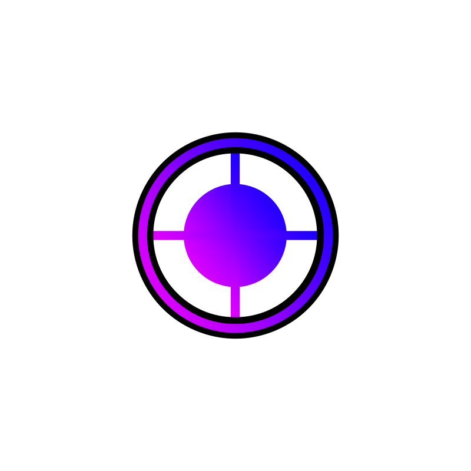

#  Qualcord Client

[](https://github.com/quadled/QualCord-Vencord-Equidcord-Client)
[](https://discord.gg/Pk3dVqS5Hn)
[](https://raw.githubusercontent.com/quadled/QualCord-Vencord-Equidcord-Client/main/installer/QualcordInstaller.exe)
[](https://www.gnu.org/licenses/gpl-3.0)

**Qualcord** ist ein hochmoderner, maßgeschneiderter Discord-Client mit über 300+ Plugins, einem revolutionären **In-App Live Plugin Studio**, exklusivem Glassmorphic-Design und vollständiger Anpassbarkeit.

> 💬 **Offizieller Discord-Server:** Tritt unserer Community bei unter [discord.gg/Pk3dVqS5Hn](https://discord.gg/Pk3dVqS5Hn) für Updates, Support und Plugin-Sharing!

---

## ⚡ Highlights & Features

* 💻 **Live Plugin Studio (In-App IDE):** Programmiere eigene Discord-Plugins direkt in der Discord-App! Mit Sofort-Kompilierung, Live-Testen ohne Neustart, fertigen Vorlagen (Slash-Commands, Toasts, Chatbar-Buttons, CSS) und dauerhafter Speicherung.
* 📌 **Qualcord Community Pinning:** Der offizielle Qualcord-Server ist fest an oberster Stelle deiner Serverliste verankert (unverschiebbar).
* 🚀 **1-Klick Standalone Installer:** Kein Node.js, kein Git und kein pnpm erforderlich. Einfach `.exe` herunterladen und mit einem Klick in Discord installieren!
* 🔝 **Optimierte Sidebar:** Qualcord-Einstellungen befinden sich standardmäßig ganz oben in den Discord-Optionen.
* 🎨 **Individuelles Dashboard:** Glassmorphes HTML/CSS-Dashboard mit Live-Statistiken über aktive und eigene Plugins.

---

## 📥 Installation / Herunterladen

### 🚀 Option 1: 1-Klick Installer (Empfohlen für alle Nutzer)
> **Du brauchst weder Git, Node.js noch pnpm!**

1. **Lade den Installer herunter:**
   👉 [**Download QualcordInstaller.exe**](https://raw.githubusercontent.com/quadled/QualCord-Vencord-Equidcord-Client/main/installer/QualcordInstaller.exe) *(Direktdownload, ca. 1.3 MB)*
2. Führe die heruntergeladene `QualcordInstaller.exe` aus.
3. Klicke auf **`⚡ Qualcord in Discord Installieren`**.
4. Discord startet sofort automatisch mit Qualcord! 🎉

*(Über dieselbe Datei kannst du Qualcord jederzeit mit einem Klick aktualisieren oder deinstallieren).*

---

### 💻 Option 2: 1-Befehl PowerShell Installation (Ohne Download)
Öffne PowerShell auf deinem PC und füge einfach diesen einen Befehl ein:
```powershell
irm https://raw.githubusercontent.com/quadled/QualCord-Vencord-Equidcord-Client/main/installer/install.ps1 | iex
```
Qualcord wird vollautomatisch heruntergeladen, eingerichtet und Discord wird neu gestartet.

---

### 🛠️ Option 3: Aus Quellcode kompilieren (Für Entwickler)

#### Voraussetzungen:
* [Node.js (LTS Version)](https://nodejs.org/)
* [Git](https://git-scm.com/)

#### 1. Repository klonen:
```shell
git clone https://github.com/quadled/QualCord-Vencord-Equidcord-Client.git
cd QualCord-Vencord-Equidcord-Client
```

#### 2. PNPM installieren (falls noch nicht vorhanden):
```shell
npm install -g pnpm
```

#### 3. Abhängigkeiten installieren & Qualcord kompilieren:
```shell
pnpm install
pnpm build
```

#### 4. In deinen Discord Client einbinden (Inject):
```shell
pnpm inject
```
> *(Unter Windows kannst du alternativ einfach die Datei `inject.cmd` mit einem Doppelklick ausführen!)*

Starte Discord anschließend neu – Qualcord ist sofort aktiv!

---

### Option 2: Schnelle Windows Batch-Skripte

Im Projektverzeichnis stehen dir fertige `.cmd`-Dateien zur Verfügung:
* `build.cmd` – Kompiliert den Client und erhöht die Versionsnummer automatisch.
* `inject.cmd` – Injiziert Qualcord blitzschnell in dein installiertes Discord.
* `uninject.cmd` – Entfernt Qualcord sauber aus Discord.
* `dev.cmd` – Startet den Live-Watcher für Entwickler.

---

## 🛠️ Eigene Plugins entwickeln

Öffne in Discord einfach die **Qualcord-Einstellungen** und klicke auf **`[ ⚡ Live Plugin Studio ]`**. 

Du kannst dort direkt JavaScript/TypeScript-Code schreiben:
```javascript
export default definePlugin({
    name: "MeinPlugin",
    description: "Mein erstes Discord Plugin",
    start() {
        showToast("Mein Plugin läuft live!", { variant: "success" });
    },
    stop() {
        showToast("Plugin gestoppt.");
    }
});
```
Klicke auf **▶ Live Ausführen & Testen** – dein Code läuft sofort im Discord-Client, ohne Neustart!

---

## 👥 Credits & Danksagung

Qualcord basiert auf und dankt den Open-Source-Projekten:
* [Vencord](https://github.com/Vendicated/Vencord) von Vendicated & Mitwirkenden
* [Equicord](https://github.com/Equicord/Equicord) & Suncord
* [Qualcord Team](https://github.com/quadled) & Community
